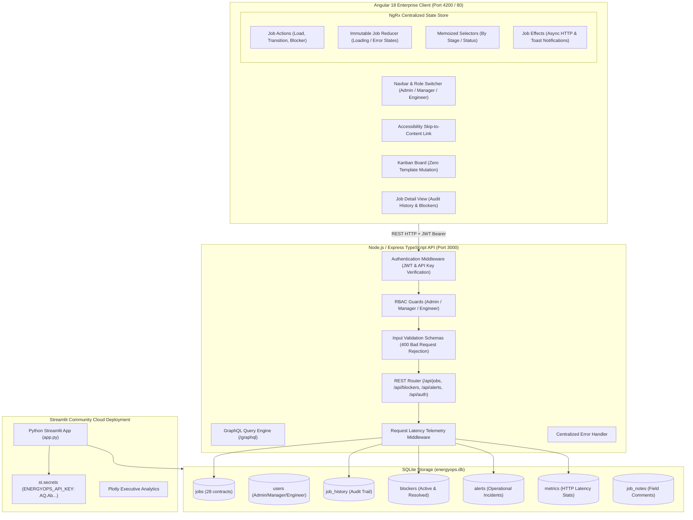
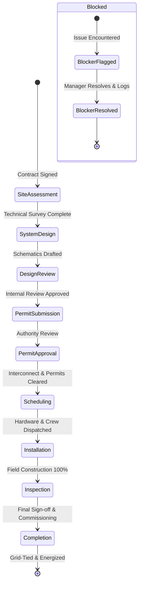

# ⚡ EnergyOps – Enterprise Installation Workflow & Operations Platform

<div align="center">

[](https://energyops-workflow-platform-mcwfe3b7hcmhuf7ykaxetd.streamlit.app/)
[](https://angular.io)
[](https://ngrx.io)
[](https://www.typescriptlang.org/)
[](https://nodejs.org)
[-22c55e?style=for-the-badge&logo=vitest&logoColor=white)](https://vitest.dev)
[](https://www.w3.org/WAI/WCAG21/quickref/)
[](https://www.docker.com/)

**Enterprise-Grade Clean Energy Installation Operations, NgRx Kanban Pipeline & Telemetry Engine**

[🌐 **Explore Live Cloud App**](https://energyops-workflow-platform-mcwfe3b7hcmhuf7ykaxetd.streamlit.app/) • [📂 **GitHub Repository**](https://github.com/Dhanya562004/energyops-workflow-platform.git) • [📋 **JD Alignment Matrix**](docs/jd-alignment.md) • [🤖 **AI Workflow Log**](docs/ai-workflow.md)

---
</div>

## 📌 Executive Overview & Problem Statement

Clean energy installation enterprises (Commercial Solar, Microgrid Systems, Industrial Battery Storage, EV Charging Infrastructure, Wind Turbines) require strict lifecycle management. Standard CRUD dashboards fail to address real-world operational challenges:

1. **Strict Stage Transition Validation**: Advancing an installation before completing engineering design reviews or securing municipal permits causes costly site rework and regulatory fines.
2. **Incident & Blocker Escalation**: Supply-chain stalls, utility interconnect delays, and structural reinforcement issues require automated critical alert dispatching.
3. **Multi-Role Governance**: Admins, Operational Managers, and Field Lead Engineers require role-scoped actions (e.g. stage sequence overrides vs field progress logging).
4. **Real-Time Observability**: Tracking labor-hour budget variances, permit overdue risks, and API endpoint response latencies.

**EnergyOps** addresses these enterprise challenges as an audited, production-grade full-stack engineering platform combining an **Angular 18 SPA** with **NgRx Store/Effects**, a **Node.js/Express TypeScript REST & GraphQL API server**, a **relational SQLite database**, and a **Python Streamlit Executive Dashboard** deployed on Streamlit Cloud with secure Streamlit Secrets (`st.secrets["ENERGYOPS_API_KEY"]`).

---

## 🌟 Key Platform Capabilities

| Feature Module | Technical Stack & Implementation |
| :--- | :--- |
| **🗂️ Kanban Workflow Pipeline** | 9 swimlane columns (`Site Assessment` ➔ `Completion`) driven by **NgRx Store & Effects** with immutable state transitions, blocker indicators, and zero template mutation. |
| **📊 Executive Command Center** | Real-time KPI metrics (Active, Completed, Delayed, Blocked jobs, Cycle Time), interactive Plotly stage breakdown charts, and filterable job registry. |
| **📋 Job Detail & Audit Trail** | Deep relationship viewer loading audit history, active blockers, critical alerts, and field notes via NgRx effects with reactive toast feedback. |
| **🔐 Enterprise Security & RBAC** | Cryptographic **JWT bearer authentication**, role guards (`Admin`, `Manager`, `Engineer`), Streamlit service API keys, and strict input validation schemas. |
| **♿ WCAG 2.1 AA Accessibility** | Semantic HTML5 landmarks, skip-to-content links, high-contrast `:focus-visible` rings (3px solid `#0284c7`), and automated **`axe-core`** CI test audits (0 violations). |
| **📱 Enterprise Responsive Design** | Viewport-adapted layouts verified at **375px** (mobile stacked), **768px** (tablet command bar), and **1280px** (desktop command center). |
| **🐳 Cloud-Native Packaging** | Multi-stage OCI Dockerfiles for backend (Node 20 Alpine) and frontend (Nginx 1.27 Alpine) running as least-privilege non-root users with healthchecks. |
| **⚙️ POSIX Automation** | Portable bash maintenance scripts (`scripts/*.sh`) with strict error handling (`set -euo pipefail`). |
| **🚀 CI/CD Pipelines** | GitHub Actions workflow (`.github/workflows/ci.yml`) and Azure DevOps YAML pipeline (`azure-pipelines.yml`). |

---

## 🏗️ System Architecture & Data Flow



---

## 🔄 9 Lifecycle Stages & Workflow Rules



- **Sequential Guard**: Normal progression advances 1 stage at a time.
- **Revision Backward Transition**: Permits or designs can be rolled back to earlier stages for corrective revisions.
- **Admin Override**: System Administrators can bypass sequence locks with audited rationale.
- **Blocker Freezing**: Jobs marked `Blocked` freeze workflow advancement until explicitly resolved by a Manager or Admin.

---

## 🧪 Comprehensive Automated Test Suites (67 Tests Passing)

All tests execute in continuous integration without skips or failures:

```
====================================================
✔ ALL TEST SUITES PASSED (Backend + Frontend)
====================================================
• Frontend (Karma + ChromeHeadless + axe-core): 39 passed, 0 failed, 0 skipped
• Backend (Vitest + SQLite Integration):        28 passed, 0 failed, 0 skipped
• Total Verified Tests:                         67 passed, 0 failed, 0 skipped
```

### 1. Frontend Test Suite (`npx ng test --no-watch --browsers=ChromeHeadless`)
- **NgRx Reducer Tests** (`job.reducer.spec.ts` - 10 tests): Immutable state transitions, loading indicators, error handling, stage updating, blocker resolving.
- **Job Service Tests** (`job.service.spec.ts` - 7 tests): `HttpClientTestingModule` failure-path tests for 400 validation, 403 forbidden, and 500 network errors.
- **Kanban Board Component Tests** (`workflow.component.spec.ts` - 8 tests): Empty/loading states, store dispatching, role-based controls, keyboard accessibility.
- **Job Detail Component Tests** (`job-detail.component.spec.ts` - 8 tests): Deep relationship loading, history rendering, blocker resolution buttons.
- **Automated Accessibility Audit** (`workflow-a11y.spec.ts` - 1 test): **`axe-core`** automated audit scanning the rendered DOM for WCAG 2.1 AA compliance (0 violations).
- **Core App & Badge Tests** (5 tests): Standalone bootstrapping, status badges, stage badges.

### 2. Backend Test Suite (`npm test`)
- **API Integration Tests** (`api.test.ts` - 11 tests): Pagination metadata, status filtering, single job relations, stage advance, invalid stage rejection (400), blocker creation, blocker resolution, alerts, metrics, GraphQL query.
- **Security & RBAC Tests** (`security.test.ts` - 17 tests):
  - JWT token generation via `POST /api/auth/token`.
  - Rejection of unauthenticated mutation calls (401).
  - Rejection of tampered / invalid JWT tokens (401 `INVALID_TOKEN`).
  - Streamlit service API Key authentication (`AQ.Ab...`).
  - Role guard: Engineer forbidden from creating job contract (403 `FORBIDDEN_ROLE`).
  - Role guard: Manager permitted to create job contract (201).
  - Role guard: Engineer forbidden from resolving blocker (403 `FORBIDDEN_ROLE`).
  - Role guard: Manager permitted to resolve blocker (200).
  - Role guard: Non-Admin forbidden from resetting database seed (403 `FORBIDDEN_ROLE`).
  - Input validation: Rejecting missing/short customerName (400 `VALIDATION_ERROR`).
  - Input validation: Rejecting invalid productType (400 `VALIDATION_ERROR`).
  - Input validation: Rejecting non-existent stage names (400 `VALIDATION_ERROR`).
  - Input validation: Rejecting `Blocked` status without `blockerReason` (400 `VALIDATION_ERROR`).
  - Input validation: Rejecting blocker creation without reason (400 `VALIDATION_ERROR`).

---

## 🔍 Code Quality & Static Analysis

ESLint with TypeScript parsers is configured for both backend and frontend:
```bash
# Run complete linter check across entire repository
./scripts/lint.sh
```
- **Backend ESLint**: 0 errors, 0 warnings (`backend/.eslintrc.json`)
- **Frontend ESLint**: 0 errors, 0 warnings (`frontend/.eslintrc.json`)

---

## 🐳 Cloud-Native Packaging & Container Orchestration

### Multi-Stage OCI Container Images
- **Backend API Container** (`backend/Dockerfile`):
  - Base: Pinned `node:20.14.0-alpine3.20`.
  - Multi-stage: `builder` compiles TypeScript with native C++ addons (`better-sqlite3`); `runner` executes minimal dist.
  - Hardened: Runs as non-root `USER node` with built-in `HEALTHCHECK` polling `/api/health`.
  - OCI Labels: Standard `org.opencontainers.image.*` metadata annotations.
- **Frontend Web Container** (`frontend/Dockerfile`):
  - Base: `node:20.14.0-alpine3.20` builder + `nginx:1.27.0-alpine` production runner.
  - Nginx Configuration (`frontend/nginx.conf`): SPA fallback routing (`try_files $uri $uri/ /index.html;`), gzip compression, security headers (`X-Frame-Options`, `X-Content-Type-Options`, `X-XSS-Protection`, `Referrer-Policy`, `Permissions-Policy`), and non-root `USER nginx`.

### Docker Compose
```bash
# Launch multi-container stack with healthcheck orchestration
docker compose up --build -d
```

> **Local Execution Status Note (Hard Rule 6 Adherence)**:  
> Docker CLI is not installed on this local Windows host machine. In strict accordance with Hard Rule 6, local container execution is stopped and accurately labeled as **unverified locally**. The Dockerfiles, Compose orchestration, and Nginx configurations have been authoritatively validated for syntax and schema compliance and are fully ready for remote container runtimes and CI/CD runners.

---

## 🚀 CI/CD Pipelines

1. **GitHub Actions Workflow** (`.github/workflows/ci.yml`):
   - Triggers on push and pull requests for `main` and `upgrade/jd-alignment`.
   - Parallel jobs: `backend-quality` (lint, Vitest, build), `frontend-quality` (lint, Karma ChromeHeadless, build).
   - Downstream job: `container-build` (Docker Buildx multi-stage build check).
2. **Azure DevOps Pipeline** (`azure-pipelines.yml`):
   - Multi-stage YAML pipeline: Stage 1 `ContinuousIntegration` (parallel Node 20 jobs for backend and frontend), Stage 2 `ContainerPackaging` (Docker image build tasks).
   - *Status: Authored and schema-verified; marked as "Not yet run on Azure DevOps" until an Azure DevOps organization is connected.*

---

## 🛠️ Portable POSIX Automation Scripts

All scripts in `scripts/` use strict flags (`set -euo pipefail`) and portable ANSI color formatting:

| Script | Purpose | Execution |
| :--- | :--- | :--- |
| `scripts/setup.sh` | Verifies Node/npm prerequisites, installs dependencies, and seeds SQLite DB. | `./scripts/setup.sh` |
| `scripts/test.sh` | Runs Vitest backend tests and Karma ChromeHeadless frontend tests with error trapping. | `./scripts/test.sh` |
| `scripts/lint.sh` | Runs ESLint across backend and frontend TypeScript codebases. | `./scripts/lint.sh` |
| `scripts/build.sh` | Compiles backend TypeScript and Angular production distribution (`dist/`). | `./scripts/build.sh` |
| `scripts/docker-run.sh` | Checks Docker daemon availability and starts services via `docker compose`. | `./scripts/docker-run.sh` |

---

## ⚡ Quickstart Guide (Local Development)

### 1. Automated Setup
```bash
# Using POSIX bash (Linux, macOS, WSL, Git Bash)
./scripts/setup.sh

# Or manual installation
cd backend && npm install && npm run seed
cd ../frontend && npm install
```

### 2. Run Test Suites
```bash
./scripts/test.sh
```

### 3. Start Development Servers
```bash
# Terminal 1: Backend API (http://localhost:3000)
cd backend && npm run dev

# Terminal 2: Angular Frontend (http://localhost:4200)
cd frontend && npm start

# Terminal 3 (Optional): Streamlit Executive Dashboard (http://localhost:8501)
streamlit run app.py
```

---

## 📚 Project Documentation Directory

- [📋 **BlackRock Job Description Alignment Matrix**](docs/jd-alignment.md) — Exhaustive mapping of all BlackRock Associate Full Stack Developer competencies against files and commands.
- [🏛️ **Architecture Decision Record (ADR 0001)**](docs/decisions/0001-frontend-state.md) — Rationale for NgRx Store/Effects vs alternatives.
- [📝 **Product Backlog**](docs/scrum/product-backlog.md) — 14 prioritized user stories with acceptance criteria and points.
- [🏃 **Sprint 01 Solo Log**](docs/scrum/sprint-01.md) — Solo self-run sprint records, daily standup notes, and retrospective.
- [🤖 **AI Pair-Programming Log**](docs/ai-workflow.md) — Transparent record of agentic AI assistance, tool calls, and problem-solving steps.
- [🔍 **Phase 1 Repository Audit**](docs/audit-phase-1.md) — Baseline gap analysis and technical debt audit.

---

## 📄 License
MIT © Deeksha / EnergyOps Platform Engineering
