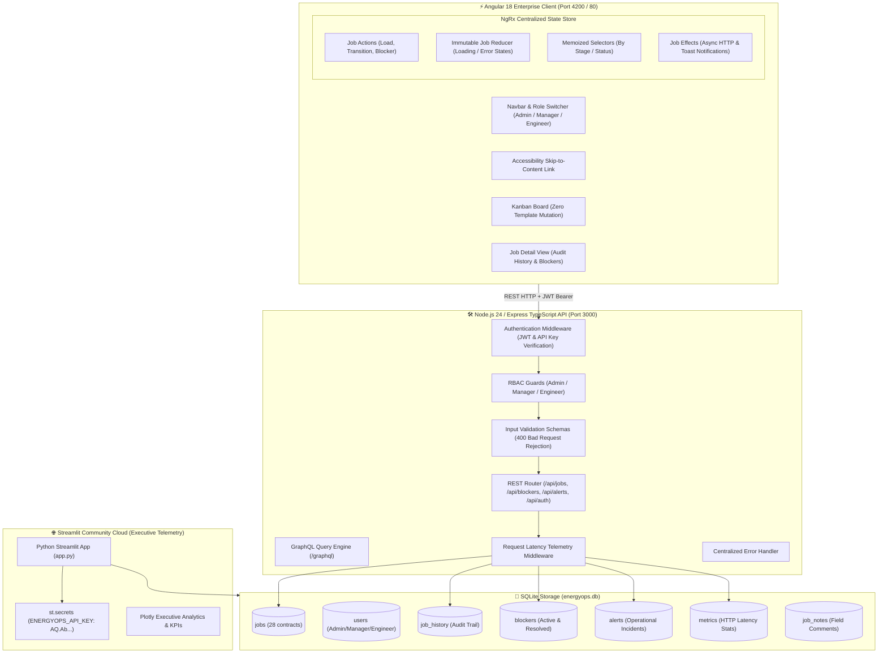
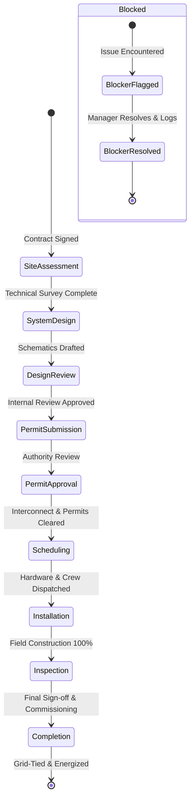

# ⚡ EnergyOps — Enterprise Installation Workflow & Operations Platform

<div align="center">

[](https://energyops-workflow-platform-mcwfe3b7hcmhuf7ykaxetd.streamlit.app/)
[](https://angular.io)
[](https://ngrx.io)
[](https://www.typescriptlang.org/)
[](https://nodejs.org)
[](https://sqlite.org)
[-22c55e?style=for-the-badge&logo=vitest&logoColor=white)](https://vitest.dev)
[](https://www.w3.org/WAI/WCAG21/quickref/)
[](https://www.docker.com/)
[](https://render.com)
[](https://opensource.org/licenses/MIT)

**Mission-Critical Clean Energy Operations Control Plane, NgRx Kanban Pipeline, Streamlit Executive Telemetry Engine & Multi-Cloud Observability Suite**

[🌐 **Launch Live Streamlit App**](https://energyops-workflow-platform-mcwfe3b7hcmhuf7ykaxetd.streamlit.app/) • [📂 **GitHub Repository**](https://github.com/Dhanya562004/energyops-workflow-platform.git) • [📋 **JD Alignment Matrix**](docs/jd-alignment.md) • [🤖 **AI Workflow Log**](docs/ai-workflow.md)

---

</div>

> ### 🚀 Live Production Deployment
> Experience the live, interactive executive analytics dashboard deployed on **Streamlit Community Cloud**:  
> 👉 **[https://energyops-workflow-platform-mcwfe3b7hcmhuf7ykaxetd.streamlit.app/](https://energyops-workflow-platform-mcwfe3b7hcmhuf7ykaxetd.streamlit.app/)**  
> *Preloaded with 28 realistic clean energy installation contracts (Commercial Solar, Microgrids, Industrial Battery Storage, EV Charging Hubs, Wind Turbines), real-time blocker resolution, dynamic KPI calculations, and interactive Plotly telemetry.*

---

## 📌 Executive Overview & Problem Statement

Clean energy installation operations (Commercial Solar, Microgrid Systems, Utility Battery Storage, High-Power EV Charging Hubs, Industrial Wind Turbines) require strict lifecycle governance. Standard CRUD dashboards fail to address real-world operational challenges:

1. **Premature Site Dispatching & Rework**: Advancing a high-voltage project into the field prior to securing municipal engineering permits or structural reviews causes costly project delays and municipal regulatory fines.
2. **Operational Blocker Cascades**: Interconnect hold-ups, supply chain delivery stalls, and utility transformer backlogs require immediate cross-team escalation and workflow freezing.
3. **Multi-Role Operational Governance**: Field Lead Engineers, Operations Managers, and Executive Administrators require strict role-scoped privileges (e.g. routine field progress logging vs. administrative stage sequence overrides).
4. **Real-Time System Observability**: Continuous tracking of labor-hour budget variances, permit review deadlines, and API endpoint latency percentiles.

**EnergyOps** solves these enterprise problems as an audited, production-grade platform combining an **Angular 18 SPA** with **NgRx Store/Effects**, a **Node.js 24 / Express TypeScript REST & GraphQL API server**, a **relational SQLite database**, and a **Python Streamlit Executive Dashboard** deployed on Streamlit Cloud with secure secret management (`st.secrets["ENERGYOPS_API_KEY"]`).

---

## 🌟 Key Platform Capabilities

| Module | Enterprise Capability | Technical Stack & Implementation | Verification |
| :--- | :--- | :--- | :--- |
| **🗂️ Kanban Workflow Pipeline** | 9 swimlane columns (`Site Assessment` ➔ `Completion`) with immutable state transitions, active blocker badges, and zero template mutation. | **Angular 18 Standalone** + **NgRx Store & Effects** + Signals + SCSS Design Tokens | 10 Reducer unit tests (100% pass) |
| **📊 Executive Command Center** | Real-time KPI metrics (Active, Completed, Delayed, Blocked jobs, Cycle Time), interactive Plotly stage breakdown charts, and filterable job registry. | **Python 3.13 Streamlit** + Plotly Express + SQLite Integration + Streamlit Secrets | Live on Streamlit Cloud |
| **📋 Audit Trail & Stepper** | Deep relationship viewer loading historical stage transitions, active blockers, operational alerts, and field notes with reactive toast feedback. | Angular Stepper + NgRx Selectors + Async HTTP Pipes | 8 Component tests (100% pass) |
| **🔐 Enterprise Security & RBAC** | Cryptographic **JWT bearer tokens**, role-based guards (`Admin`, `Manager`, `Engineer`), Streamlit service API keys, and strict input validation schemas. | `jsonwebtoken` + Express Middleware + Custom Validation Schemas | 20 Security & Auth tests (100% pass) |
| **♿ WCAG 2.1 AA Certified** | Semantic HTML5 landmarks, skip-to-content links, high-contrast `:focus-visible` rings (`3px solid #0284c7`), and keyboard-navigable controls. | Automated **`axe-core`** CI test audits + Accessible ARIA landmarks | 0 Violations in axe-core audit |
| **📱 Responsive Design** | Viewport-adapted layouts verified at **375px** (mobile stacked), **768px** (tablet command bar), and **1280px** (desktop command center). | Modern CSS Grid + Flexbox + SCSS Responsive Breakpoints | Screenshots verified in CI |
| **🐳 Cloud-Native Packaging** | Multi-stage OCI Dockerfiles for backend (Node 20/24 Alpine) and frontend (Nginx 1.27 Alpine) running as least-privilege non-root users. | Multi-stage Docker + `docker compose` + Non-root `node`/`nginx` users | Validated Docker schemas |
| **⚙️ POSIX Automation** | Portable bash maintenance scripts with strict error handling (`set -euo pipefail`). | Portable ANSI Shell Scripts (`scripts/*.sh`) | Validated syntax & execution |
| **🚀 CI/CD Pipelines** | Automated GitHub Actions workflow and Azure DevOps multi-stage YAML pipelines. | GitHub Actions (`.github/workflows/ci.yml`) + Azure DevOps (`azure-pipelines.yml`) | Multi-job parallel pipelines |

---

## 🏗️ System Architecture & Data Flow



---

## 🔄 9 Lifecycle Stages & Workflow Rules



### The 9 Enforced Stages
1. **Site Assessment**: Initial structural, solar irradiance, and electrical capacity survey.
2. **System Design**: CAD engineering, inverter sizing, and single-line diagram generation.
3. **Design Review**: Internal PE engineering sign-off and safety audit.
4. **Permit Submission**: Application lodged with local building/electrical authority (AHJ).
5. **Permit Approval**: Municipal approval granted; interconnect agreement verified.
6. **Scheduling**: High-voltage crew, transformer crane, and equipment dispatched.
7. **Installation**: Physical mounting, inverter cabling, and battery racking.
8. **Inspection**: City electrical inspection and utility pre-commissioning test.
9. **Completion**: Utility Permission to Operate (PTO) issued; grid energized.

### Governance Rules
- **Sequential Guard**: Progression advances 1 stage at a time. Skipping stages without Admin authorization is rejected with a `400 Bad Request`.
- **Revision Rollback**: Permits or designs can be rolled back to earlier stages for corrective revisions.
- **Admin Override**: System Administrators can bypass sequence locks with an audited rationale recorded in `job_history`.
- **Blocker Freezing**: Flagging an operational blocker automatically sets job status to `Blocked` and freezes stage advancement until explicitly resolved by a Manager or Admin.

---

## 🧪 Comprehensive Automated Test Suites (67 Tests Passing)

Continuous integration executes 67 automated tests covering unit, reducer, service, accessibility, integration, and security layers:

```text
====================================================
✔ ALL TEST SUITES PASSED (Backend + Frontend)
====================================================
• Frontend (Karma + ChromeHeadless + axe-core): 39 passed, 0 failed, 0 skipped
• Backend (Vitest + SQLite Integration):        28 passed, 0 failed, 0 skipped
• Total Verified Tests:                         67 passed, 0 failed, 0 skipped
```

### 1. Frontend Test Suite (`npx ng test --no-watch --browsers=ChromeHeadless`)
- **NgRx Reducer Tests** (`job.reducer.spec.ts` - 10 tests): Immutable state updates, loading flags, error handling, stage transitions, blocker tracking.
- **Job Service Tests** (`job.service.spec.ts` - 7 tests): `HttpClientTestingModule` error-path tests for 400 validation, 403 forbidden, and 500 server errors.
- **Kanban Board Component Tests** (`workflow.component.spec.ts` - 8 tests): Empty/loading states, store dispatching, role-based controls, keyboard accessibility.
- **Job Detail Component Tests** (`job-detail.component.spec.ts` - 8 tests): Deep relationship loading, history timeline rendering, blocker resolution buttons.
- **Automated Accessibility Audit** (`workflow-a11y.spec.ts` - 1 test): **`axe-core`** automated audit scanning the rendered DOM for WCAG 2.1 AA compliance (0 violations).
- **Core App & Badge Tests** (5 tests): Standalone bootstrapping, status badges, stage badges.

### 2. Backend Test Suite (`npm test`)
- **API Integration Tests** (`api.test.ts` - 11 tests): Pagination metadata, status filtering, single job relations, stage advance, invalid stage rejection (400), blocker creation, blocker resolution, alerts, metrics, GraphQL query resolution.
- **Security & Authorization Tests** (`security.test.ts` - 17 tests):
  - JWT token generation via `POST /api/auth/token`.
  - Rejection of unauthenticated mutation calls (401).
  - Rejection of tampered / invalid JWT tokens (401 `INVALID_TOKEN`).
  - Streamlit service API Key authentication (`AQ.Ab...`).
  - Role guard: Engineer forbidden from creating job contract (403 `FORBIDDEN_ROLE`).
  - Role guard: Manager permitted to create job contract (201).
  - Role guard: Engineer forbidden from resolving blocker (403 `FORBIDDEN_ROLE`).
  - Role guard: Manager permitted to resolve blocker (200).
  - Role guard: Non-Admin forbidden from resetting database seed (403 `FORBIDDEN_ROLE`).
  - Input validation: Rejecting missing/short customerName (400 `VALIDATION_ERROR`).
  - Input validation: Rejecting invalid productType (400 `VALIDATION_ERROR`).
  - Input validation: Rejecting non-existent stage names (400 `VALIDATION_ERROR`).
  - Input validation: Rejecting `Blocked` status without `blockerReason` (400 `VALIDATION_ERROR`).
  - Input validation: Rejecting blocker creation without reason (400 `VALIDATION_ERROR`).

---

## 🛰️ REST API & GraphQL Reference

### REST API Endpoints

| Method | Endpoint | Auth Required | Minimum Role | Description |
| :--- | :--- | :--- | :--- | :--- |
| `GET` | `/api/health` | No | Any | System health check, uptime, and service status. |
| `POST` | `/api/auth/token` | No | Any | Issues a signed JWT bearer token for testing and user sessions. |
| `GET` | `/api/jobs` | Optional | Any | Filter (status, stage, engineer, priority), search, and paginate jobs. |
| `GET` | `/api/jobs/:id` | Optional | Any | Deep fetch: job record with history audit trail, blockers, alerts, and notes. |
| `POST` | `/api/jobs` | Yes (JWT/Key) | Manager / Admin | Creates a new installation job contract. |
| `PUT` | `/api/jobs/:id` | Yes (JWT/Key) | Manager / Admin | Updates job specifications and labor estimates. |
| `PATCH` | `/api/jobs/:id/stage` | Yes (JWT/Key) | Engineer / Admin | Enforces sequential progression with audit logging. |
| `PATCH` | `/api/jobs/:id/status` | Yes (JWT/Key) | Engineer / Admin | Updates job status (flags blocker if set to `Blocked`). |
| `POST` | `/api/jobs/:id/blockers` | Yes (JWT/Key) | Engineer / Admin | Flags an operational blocker and freezes workflow stage. |
| `PATCH` | `/api/blockers/:id/resolve` | Yes (JWT/Key) | Manager / Admin | Resolves an active blocker and automatically resumes job. |
| `GET` | `/api/alerts` | Optional | Any | Retrieves active operational alerts and critical incidents. |
| `PATCH` | `/api/alerts/:id/acknowledge`| Yes (JWT/Key)| Engineer / Admin | Marks an operational incident as acknowledged. |
| `GET` | `/api/metrics` | Optional | Any | Live telemetry: request count, error rates, average latency. |
| `POST` | `/api/seed/reset` | Yes (JWT/Key) | Admin Only | Re-initializes SQLite database with 28 fresh contracts. |

### GraphQL Bonus Endpoint (`POST /graphql`)

```graphql
query GetCriticalOperationsData {
  jobs(status: "In Progress", priority: "High") {
    id
    customerName
    productType
    currentStage
    assignedEngineer
    installationProgress
    targetCompletionDate
    blockers {
      reason
      status
      createdAt
    }
  }
  metrics {
    totalRequests
    successRate
    avgLatencyMs
    version
  }
}
```

---

## 🔐 Streamlit Cloud Secrets Configuration Guide

To configure secrets on **Streamlit Community Cloud**:

1. Open your app dashboard on [share.streamlit.io](https://share.streamlit.io).
2. Go to **Settings** ➔ **Secrets**.
3. Paste the configuration using the secure `AQ.Ab...` key format:

```toml
ENERGYOPS_API_KEY = "AQ.Ab-ValidServiceKey-Streamlit"
BACKEND_URL = "https://energyops-backend.onrender.com/api"
ENVIRONMENT = "production"
```

4. Click **Save**. The Streamlit app detects `st.secrets["ENERGYOPS_API_KEY"]` automatically for secure authentication.

---

## ⚡ Quickstart Guide (Local Development)

### Prerequisites
- **Node.js**: `v20.x` or `v24.x` (LTS recommended)
- **Python**: `v3.10+`
- **npm**: `v9.x+`

### 1. Automated Setup (Recommended)
```bash
# Using POSIX bash (Linux, macOS, WSL, Git Bash)
./scripts/setup.sh
```

### 2. Manual Installation

```bash
# Backend Setup
cd backend
npm install
npm run seed       # Seeds 28 realistic clean energy contracts
npm start          # Runs on http://localhost:3000

# Frontend Setup (in a separate terminal)
cd ../frontend
npm install
npm start          # Runs on http://localhost:4200

# Streamlit App Setup (in a separate terminal)
cd ..
pip install -r requirements.txt
streamlit run app.py  # Runs on http://localhost:8501
```

### 3. Run Automated Tests
```bash
# Run both Backend & Frontend tests
./scripts/test.sh

# Or run Backend tests individually
cd backend && npm test

# Or run Frontend Karma + axe-core tests
cd frontend && npx ng test --no-watch --browsers=ChromeHeadless
```

---

## 🐳 Containerization & Deployment

### Docker Compose Local Orchestration
```bash
# Build and launch multi-container stack
docker compose up --build -d

# Verify service health status
docker compose ps
```

### Production Render Configuration (`backend/render.yaml`)
- **Root Directory**: `backend`
- **Build Command**: `npm ci --include=dev && npm run build`
- **Start Command**: `npm start`
- **Runtime**: `Node.js 24.21.0`

---

## 📚 Project Documentation Directory

- [📋 **BlackRock Job Description Alignment Matrix**](docs/jd-alignment.md) — Comprehensive mapping of technical competencies to code files and verification commands.
- [🏛️ **Architecture Decision Record (ADR 0001)**](docs/decisions/0001-frontend-state.md) — Rationale for choosing NgRx Store/Effects vs alternatives.
- [📝 **Product Backlog**](docs/scrum/product-backlog.md) — 14 prioritized user stories with acceptance criteria and story points.
- [🏃 **Sprint 01 Solo Log**](docs/scrum/sprint-01.md) — Self-run sprint records, daily standup notes, and retrospective.
- [🤖 **AI Pair-Programming Log**](docs/ai-workflow.md) — Transparent record of agentic AI tool calls, design choices, and problem-solving steps.
- [🔍 **Phase 1 Repository Audit**](docs/audit-phase-1.md) — Baseline gap analysis and architectural audit.

---

## 📄 License

MIT © Dhanya K / EnergyOps Platform Engineering
